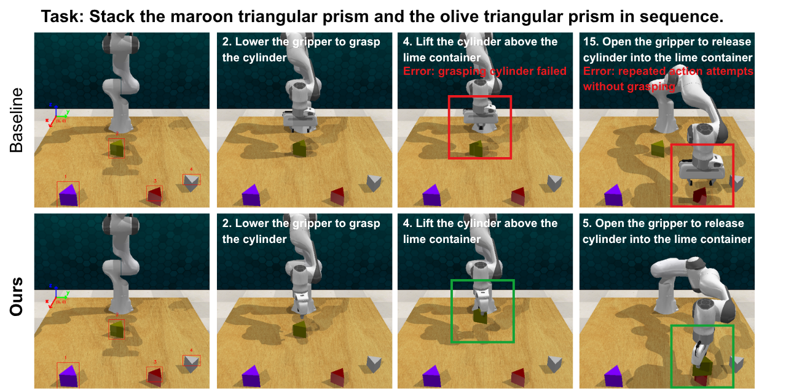
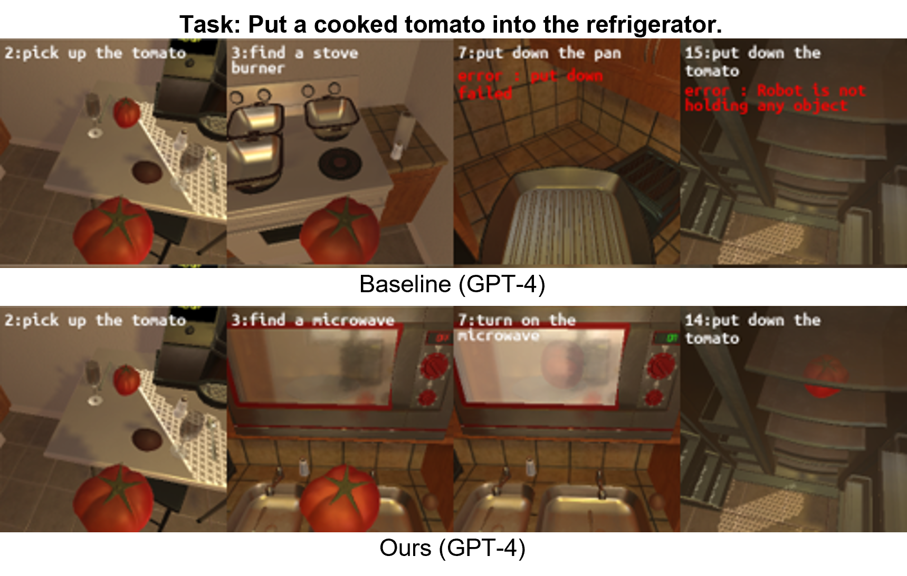

I am a first-year Ph.D. student in the [Graduate School of Artificial Intelligence](https://aigs.unist.ac.kr/) at the [Ulsan National Institute of Science and Technology (UNIST)](https://www.unist.ac.kr), working in the [IMML Lab](https://sites.google.com/view/imml-lab) under the supervision of Prof. Taehwan Kim. I received my B.S. degree in Computer Engineering from Tech University of Korea.

My research interests include Embodied AI, Vision-Language Models, Vision-Language Action Models, Multimodal Learning, and Embodied Reasoning. I am particularly interested in developing embodied agents and VLAs that can understand their environments, reason from past experiences, and calibrate the failure actions for long-horizon and generalizable decision-making.

## News

  
<strong>[May. 2026]</strong> One paper accepted at <strong class="news-venue">Embodied AI Workshop @ CVPR 2026</strong>: <a href="https://jinsikbang.github.io"><em>Trajectory-aware Success and Failure Experience Retrieval for VLM Agent</em></a>, Denver
    
Somin Lee, <strong>Jinsik Bang</strong>, and Taehwan Kim

  

  

  
<strong>[Feb. 2026]</strong> One paper accepted at <strong class="news-venue">CVPRF 2026</strong>: <a href="https://openaccess.thecvf.com/content/CVPR2026F/html/Bang_Environmental_Understanding_Vision-language_Model_for_Embodied_Agent_CVPRF_2026_paper.html"><em>Environmental Understanding Vision-Language Model for Embodied Agent</em></a>
    
<strong>Jinsik Bang</strong>, Jaeyeon Bae, Donggye Lee, Siyeol Jung, and Taehwan Kim

  

  

  
<strong>[Mar. 2025]</strong> One paper accepted at <strong class="news-venue">CVPRW 2025</strong>: <a href="https://openaccess.thecvf.com/content/CVPR2025W/FGVC/html/Lee_Multi-aspect_Knowledge_Distillation_with_Large_Language_Model_CVPRW_2025_paper.html"><em>Multi-aspect Knowledge Distillation with LLM</em></a>
    
Taegyeong Lee*, <strong>Jinsik Bang</strong>*, Soyeong Kwon, and Taehwan Kim <em>(* equal contribution)</em>

  

  

  
<strong>[May. 2024]</strong> One paper accepted at <strong class="news-venue">Embodied AI Workshop @ CVPR 2024</strong>: <a href="https://embodied-ai.org/papers/2024/29_Environmental_Understanding.pdf"><em>Environmental Understanding Generation with M-LLM for Embodied AI</em></a>, Seattle
    
<strong>Jinsik Bang</strong>, and Taehwan Kim

  

  

  
<strong>[Mar. 2024]</strong> Started integrated M.S./Ph.D. program at UNIST IMML Lab

## Contact

[bang@unist.ac.kr](mailto:bang@unist.ac.kr) · UNIST, Ulsan, South Korea
