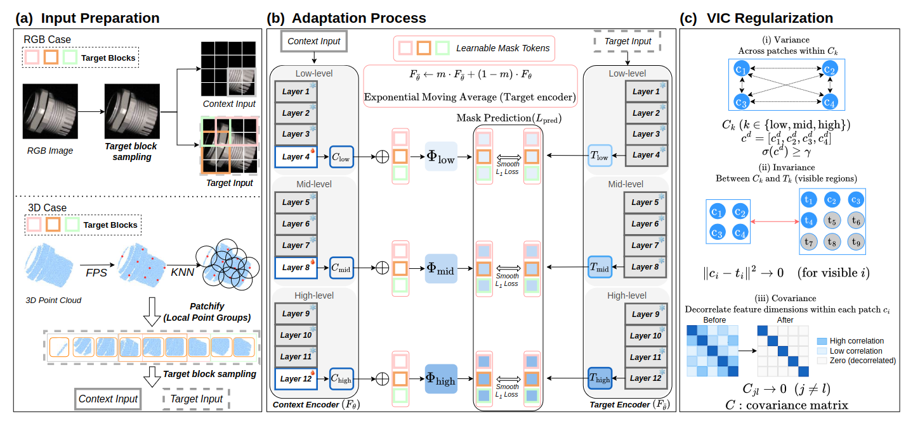
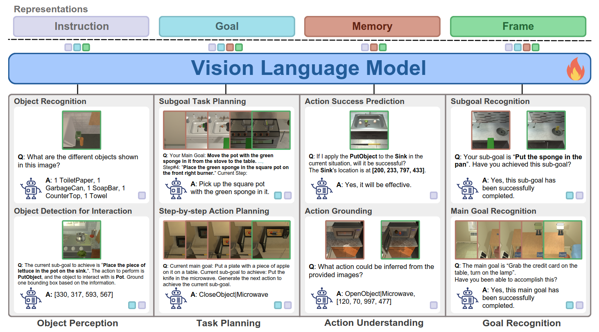
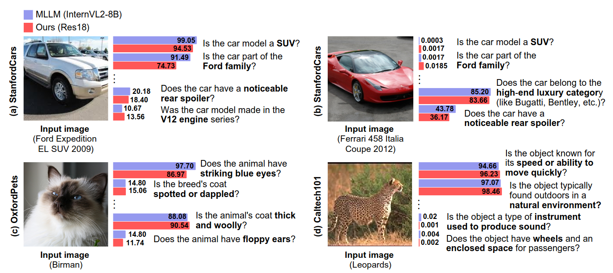

I am a first-year Ph.D. student in the [Graduate School of Artificial Intelligence](https://aigs.unist.ac.kr/) at the [Ulsan National Institute of Science and Technology (UNIST)](https://www.unist.ac.kr), working in the [IMML Lab](https://sites.google.com/view/imml-lab) under the supervision of Prof. Taehwan Kim. I received my B.S. degree in Computer Engineering from Tech University of Korea.

My research in Embodied AI aims to enhance the reasoning capabilities of agents, enabling them to understand their environments and make decisions on their own so that they can generalize to long-horizon, complex tasks. In particular, I leverage VLMs, VLAs, and WAMs to achieve generalization that extends beyond simulators to the real world.

## News

<ul class="news-list">
  <li>[Oct.2026]One paper accepted at <strong class="news-venue">WACV 2027</strong></li>
  <li>[May.2026]One paper accepted at <strong class="news-venue">Embodied AI Workshop @ CVPR 2026</strong></li>
  <li>[Feb.2026]One paper accepted at <strong class="news-venue">CVPR Findings 2026</strong></li>
  <li>[Mar.2025]One paper accepted at <strong class="news-venue">FGVC Workshop @ CVPR 2025</strong></li>
  <li>[May.2024]One paper accepted at <strong class="news-venue">Embodied AI Workshop @ CVPR 2024</strong></li>
  <li>[Mar.2024]Started integrated M.S./Ph.D. program at UNIST IMML Lab</li>
</ul>

## Publications

  
  

    
Embedding Predictive Adaptation and Refinement for Multi-Modal Industrial Anomaly Detection

    
Jaeho Cho, <strong>Jinsik Bang</strong>, and Taehwan Kim

    
WACV 2027

    

      <a href="https://arxiv.org/pdf/2611.09521">[Paper]</a>
      <a href="https://arxiv.org/pdf/2611.09521">[arXiv]</a>
      <a href="https://github.com/ohcoheaj/EPAR">[Code]</a>
    

  

  
  

    
Environmental Understanding Vision-Language Model for Embodied Agent

    
<strong>Jinsik Bang</strong>, Jaeyeon Bae, Donggye Lee, Siyeol Jung, and Taehwan Kim

    
CVPR Findings 2026

    

      <a href="https://openaccess.thecvf.com/content/CVPR2026F/html/Bang_Environmental_Understanding_Vision-language_Model_for_Embodied_Agent_CVPRF_2026_paper.html">[Paper]</a>
      <a href="https://arxiv.org/abs/2604.19839">[arXiv]</a>
      <a href="https://eu-ea.github.io">[Project Page]</a>
      <a href="https://github.com/jinsikbang/EUEA">[Code]</a>
    

  

  
  

    
Multi-aspect Knowledge Distillation with Large Language Model

    
Taegyeong Lee*, <strong>Jinsik Bang</strong>*, Soyeong Kwon, and Taehwan Kim <em>(* equal contribution)</em>

    
FGVC Workshop @ CVPR 2025

    

      <a href="https://openaccess.thecvf.com/content/CVPR2025W/FGVC/html/Lee_Multi-aspect_Knowledge_Distillation_with_Large_Language_Model_CVPRW_2025_paper.html">[Paper]</a>
      <a href="https://arxiv.org/abs/2501.13341">[arXiv]</a>
      <a href="https://github.com/taegyeong-lee/MaKD-Multi-aspect-knowledge-distillation-with-Large-Language-Model">[Code]</a>
    

  

## Contact

[bang@unist.ac.kr](mailto:bang@unist.ac.kr) · UNIST, Ulsan, South Korea
